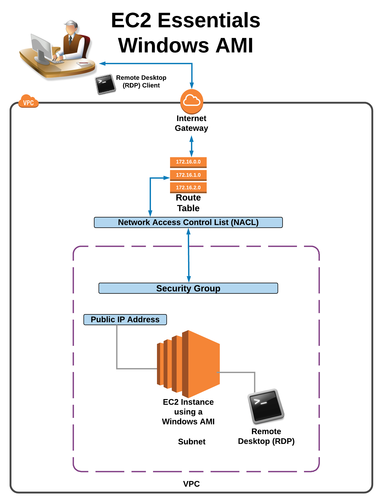

This folder contains resources to create a VPC, Subnets, etc. needed for Windows RDP Lab.  The below daigram shows the resources created by the CloudFormation template.

Steps to create AWS resources and Windows AMI.

1. Create and run stack to create VPC, etc. needed for the lab using the [rdp_example_vpc.yaml](rdp_example_vpc.yaml)
2. Update Stack to added security group allowing RDP
3. 
